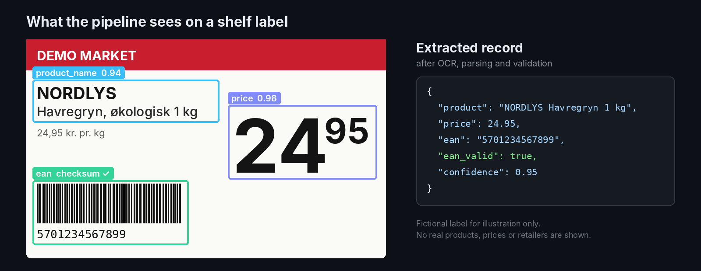
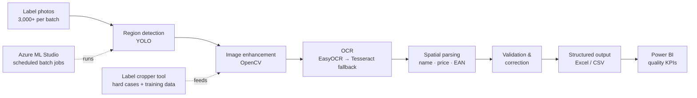

# Label OCR Pipeline

[](https://github.com/aleks-al-aleksandrov/label-ocr-pipeline/actions/workflows/tests.yml)


**Computer vision + OCR pipeline that turns photos of retail shelf labels into clean, validated product data.**
Built on my own as a Student Assistant in Commercial Analytics at Salling Group (2025).

| | |
|---|---|
| **Result** | Extraction time from **~2 weeks to 3–4 days per batch** (~70% less) |
| **Scale** | **3,000+ labels** per batch |
| **My role** | Sole developer: requirements, pipeline design, implementation, rollout |
| **Stack** | Python · OpenCV · YOLO · EasyOCR · Tesseract · PyTorch · pandas · Azure ML Studio · Power BI |

> [!IMPORTANT]
> **About the code in this repository.** The production pipeline was built during my employment, and its code, model and data belong to Salling Group. Out of respect for that, this repository documents the problem, the architecture and what I learned, together with **clean, tested re-implementations of the validation logic** in [`label_ocr/`](label_ocr/validation.py). The label image is fictional. I'm happy to walk through the full design in an interview.



## The problem

The commercial analytics team needed **product name, EAN code and price** from large batches of shelf-label photos. Someone typed them into spreadsheets by hand — about **two weeks per batch**, with the typos you'd expect after a few thousand labels.

The photos were hard: taken on phones at different angles, glare on plastic label holders, small fonts, dark backgrounds, and prices printed in several layouts (`24,95`, `24,-`, big kroner with small øre).

## How it works



| Stage | What it does | Why it's built this way |
|---|---|---|
| **Detect** | Finds the label and its text regions in each photo | Cropping first means OCR only reads what matters, not shelf edges and neighbouring products |
| **Enhance** | Contrast (CLAHE), denoising, sharpening, binarisation, upscaling small text, inverting white-on-dark labels | OCR accuracy depends far more on the input image than on the OCR engine |
| **Read** | EasyOCR as the main engine, Tesseract as a fallback; several preprocessed variants per image | Different engines fail on different labels — a fallback catches what one misses |
| **Parse** | Uses *where* text sits on the label: the largest number in the price area is the price, the top-left text block is the product name, the digit run near the barcode is the EAN | Labels follow a layout; position is a stronger signal than the text alone |
| **Validate** | EAN-13 checksum and country prefix, fixing OCR digit confusions (`O→0`, `I→1`, `S→5`), plausible price range, brand dictionary for product names | A wrong value that *looks* right is worse than a missing one — every field is checked before it reaches analysts |
| **Score & export** | Confidence score per record; batch export to Excel/CSV | Low-confidence rows go to a person instead of silently into a report |
| **Monitor** | Extraction quality tracked in Power BI | So the team could see accuracy per batch, not just trust it |

Two tools support the pipeline:

- **Label cropper** — a desktop tool for drawing regions on difficult photos, which applies the same enhancement chain and saves standardised crops. Used for edge cases and for building labelled training data.
- **Batch extractor** — a desktop app that processes a folder in a background thread, shows progress and results per image, and exports the dataset.

## Validation logic (tested)

Validation is where most of the accuracy came from: OCR output is never trusted until it passes these checks. The re-implementations in [`label_ocr/validation.py`](label_ocr/validation.py) are covered by [22 tests](tests/test_validation.py) that run on every push.

```python
def is_valid_ean13(code: str) -> bool:
    """Check an EAN-13 code: weights 1,3,1,3... over the first 12 digits, the 13th is the check digit."""
    if len(code) != 13 or not code.isdigit():
        return False
    total = sum(int(digit) * (3 if i % 2 else 1) for i, digit in enumerate(code[:12]))
    return (10 - total % 10) % 10 == int(code[12])
```

| Function | What it handles |
|---|---|
| `fix_ocr_digits` | Letters OCR reads instead of digits: `O→0`, `I→1`, `S→5`, `B→8` |
| `is_valid_ean13` | EAN-13 checksum — catches most misreads of long numbers |
| `find_ean` | Prefers a standalone valid 13-digit number; rejoins groups OCR split with spaces; never glues two separate numbers into a false match |
| `parse_price` | Danish shelf formats (`24,95`, `24,-`) and rejects implausible prices |

```bash
pip install pytest
pytest -v
```

## What I learned

- **Preprocessing beats model choice.** The biggest jumps in accuracy came from better image enhancement, not from switching OCR engines.
- **Validate like the data is lying.** The EAN checksum alone catches most misreads of long numbers — cheap rules removed a whole class of errors.
- **Keep a human in the loop for the hard 5%.** Low-confidence records and difficult photos went through the cropper instead of into the dataset.
- **A trained model is an experiment until it beats the baseline.** I trained a PyTorch multi-task model (region + characters) as a next step, but the validated rule-based pipeline remained the production path.

## If I built it again

- Package the stages as separate, tested modules instead of one large script, with a labelled **evaluation set** and accuracy per field reported on every change.
- Write outputs to **Parquet with a run ID**, so every batch is reproducible and re-runs are idempotent.
- Replace hand-tuned confidence bonuses with scores **calibrated against the evaluation set**.
- Move the batch runs into a proper **orchestrator** with retries and alerting.

---

**Aleks Aleksandrov** — [GitHub profile](https://github.com/aleks-al-aleksandrov) · [LinkedIn](https://www.linkedin.com/in/aleks-aleksandrov-42a472238/)
